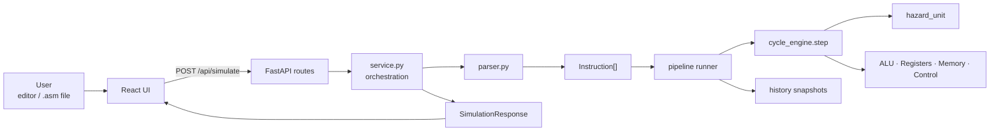

<h1 align="center">MicroArch Lab</h1>

<p align="center">
  <b>A cycle-accurate simulator for a 5-stage RISC pipeline</b><br>
  <code>IF → ID → EX → MEM → WB</code> — with hazard detection, data forwarding, and a cycle-by-cycle timeline.
</p>

<p align="center">
  
  
  
  
  
  
</p>

---

<p align="center">
  
</p>

## Overview

**MicroArch Lab** is an educational tool for understanding how a pipelined processor executes instructions.
You write (or upload) a small assembly program, and the simulator returns **one snapshot per clock cycle**:

- which instruction sits in each pipeline stage,
- every value that was **forwarded** between stages,
- when and why the pipeline **stalled** (load-use hazard),
- the state of all **32 registers** and the **data memory**.

The React front end turns that data into a pipeline timeline table. The back end does all the processor logic; the UI is display-only.

## Features

- **5-stage pipeline** — IF, ID, EX, MEM, WB, one stage per cycle per instruction.
- **Data forwarding** — MEM → EX and WB → EX paths; MEM has priority over WB; `R0` is never forwarded.
- **Load-use hazard detection** — a single-cycle stall (bubble inserted into EX) when an instruction reads the destination of a `LW` still in EX.
- **Clear error reporting** — *every* invalid line is collected and returned with its line number, not just the first one.
- **`.asm` file upload** or direct code input through the REST API.
- **Interactive API docs** (Swagger UI) at `/docs`.
- **Tested** — unit tests per component, golden-program tests, API and end-to-end tests; CI on every push.

## Supported ISA

| Type | Instructions | Example |
|---|---|---|
| R-type | `ADD` `SUB` `AND` `OR` | `ADD R3, R1, R2` |
| Immediate | `ADDI` | `ADDI R1, R0, 10` |
| Load | `LW` | `LW R2, 4(R1)` |
| Store | `SW` | `SW R1, 4(R2)` |
| No-op | `NOP` | `NOP` |

- 32 registers `R0`–`R31`; `R0` is hard-wired to `0`.
- Immediates: `-32768 … 32767` (decimal or `0x` hex).
- 32-bit signed wrap-around arithmetic.
- Data memory: word-aligned addresses `0 … 4092`; unwritten words read as `0`.
- Comments start with `#` or `;`. Max 200 instructions per program.

## Pipeline semantics

- An instruction advances **at most one stage per cycle**.
- A stall happens **only** for load-use: `LW` in EX and the instruction in ID reads its destination. It costs exactly **one cycle** — ID holds, IF freezes, EX gets a bubble, and the value is forwarded from WB one cycle later.
- Total cycles: `N + 4 + stalls`.

Example — `examples/load_use.asm` (1 load-use stall):

```
cycle:   1    2    3    4    5    6    7    8    9
I0      IF   ID   EX   MEM  WB
I1           IF   ID   EX   MEM  WB
I2                IF   ID   EX   MEM  WB
I3                     IF   ID*  ID   EX   MEM  WB
                             ^ C5: stall; C7: R2 forwarded from WB
```

## Architecture



Dependencies flow one way: `routes → service → {parser, runner} → {engine, components}`.
Nothing below `service.py` imports FastAPI, and nothing in `frontend/` computes cycles, stalls or forwarding.
See [`docs/architecture.md`](docs/architecture.md) for the full layer table and conventions.

## Project structure

```text
.github/workflows/ci.yml      CI: backend (pytest) + frontend (vitest + build)
backend/
  app/
    main.py                   FastAPI app, CORS, error handlers
    api/                      routes + orchestration service
    schemas/                  Pydantic request/response models
    core/                     parser, instruction model, ALU, registers, memory,
                              control unit, processor, hazard unit, errors
    simulator/                pipeline state, cycle engine, history
  tests/                      one test module per component + golden programs
docs/                         architecture, API contract, ISA spec, test plan/report
examples/                     reference .asm programs (incl. two error cases)
frontend/src/                 React components, hooks, API client, mock fixtures
```

## Getting started

### Back end

Requires **Python 3.11+**.

```bash
cd backend
python -m venv .venv && source .venv/bin/activate   # Windows: .venv\Scripts\activate
pip install -r requirements.txt

uvicorn app.main:app --reload --port 8000
```

Then open:

- Swagger UI — <http://127.0.0.1:8000/docs>
- Health check — <http://127.0.0.1:8000/api/health>

### Run the tests

```bash
cd backend
python -m pytest
```

### Try the API

```bash
curl -X POST http://127.0.0.1:8000/api/simulate \
  -H "Content-Type: application/json" \
  -d '{"code": "ADDI R1, R0, 10\nADDI R2, R0, 20\nADD R3, R1, R2"}'
```

Or upload a file:

```bash
curl -X POST http://127.0.0.1:8000/api/simulate/upload -F "file=@examples/basic.asm"
```

## API

| Method | Path | Description |
|---|---|---|
| `GET` | `/api/health` | Status, version, and which engine answered (`real` / `mock`) |
| `POST` | `/api/simulate` | Simulate `{"code": "..."}` |
| `POST` | `/api/simulate/upload` | Simulate an uploaded `.asm` file (≤ 100 KB, UTF-8) |

Invalid assembly is a **normal result** (HTTP 200, `success: false`, with an `errors[]` list), so the UI never has to branch on missing keys. Only transport problems use `400` / `413` / `422`.

Each response contains `total_cycles`, `stall_count`, `forward_count`, the parsed `instructions`, a per-cycle `history` (stages, forwards, registers, memory, stall info) and the `final_state`.
Full schema: [`docs/api-contract.md`](docs/api-contract.md).

## Example programs

| File | Demonstrates |
|---|---|
| `basic.asm` | simple dependent arithmetic with forwarding |
| `independent.asm` | no hazards, no forwarding |
| `arithmetic.asm` | chained ALU operations |
| `memory.asm` | `SW` / `LW` with forwarding |
| `load_use.asm` | the load-use stall |
| `nop_and_r0.asm` | `NOP` and `R0` write-protection |
| `error_unsupported_opcode.asm` | parse error (`MULT` is not supported) |
| `error_memory_alignment.asm` | simulation error (unaligned address) |

## Project status

This repository is under active development.

- [x] Assembly parser with full error collection
- [x] Instruction model, ALU, register file, data memory, control unit
- [x] Cycle engine and pipeline state
- [x] Hazard unit (load-use detection, forwarding resolution)
- [x] REST API, schemas, file upload, CI workflow
- [x] Front-end components (editor, pipeline diagram, register/memory viewers, controls, error panel)
- [ ] Pipeline runner `run_simulation` (`backend/app/core/pipeline.py`) — until it lands, the API answers with `engine: "mock"` and a warning
- [ ] Simulation history recorder (`backend/app/simulator/history.py`)
- [ ] Front-end page wiring (`Simulator.jsx`) and project setup (`package.json`)
- [ ] ISA spec and test report documents
- [ ] Golden expected results (`tests/golden/expected_results.json`)

## Documentation

- [Architecture](docs/architecture.md)
- [API contract](docs/api-contract.md)
- [ISA specification](docs/isa-spec.md)
- [Test plan](docs/test-plan.md) · [Test report](docs/test-report.md)

## Contributing

- Python 3.11+, type hints, `from __future__ import annotations`.
- Every source file starts with an `# owner: Mx` line — edit only the files you own, or coordinate with the owner.
- One branch per person, PR into `main`, reviewed by the next person in the chain.
- If you change a contract, update `docs/api-contract.md` in the same PR.

## License

Licensed under the [Apache License, Version 2.0](LICENSE).

```text
Copyright 2026 mohamed-12-tarek

Licensed under the Apache License, Version 2.0 (the "License");
you may not use this software except in compliance with the License.
You may obtain a copy of the License at

    http://www.apache.org/licenses/LICENSE-2.0

Unless required by applicable law or agreed to in writing, software
distributed under the License is distributed on an "AS IS" BASIS,
WITHOUT WARRANTIES OR CONDITIONS OF ANY KIND, either express or implied.
See the License for the specific language governing permissions and
limitations under the License.
```
