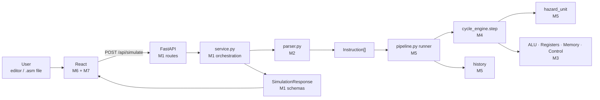

<!-- owner: M1 -->
# Architecture

MicroArch Lab simulates a 5-stage RISC pipeline (**IF → ID → EX → MEM → WB**)
cycle by cycle and shows the result as a table.



## Layers

| Layer | Files | Owner | Rule |
|---|---|---|---|
| HTTP | `app/main.py`, `app/api/routes.py` | M1 | no business logic, only translate HTTP |
| Orchestration | `app/api/service.py` | M1 | the **only** place that imports parser + runner |
| Contract | `app/schemas/*.py` | M1 | one shape for success and failure |
| Errors | `app/core/errors.py` | M1 | shared exception types + limits |
| Parsing | `app/core/instruction.py`, `app/core/parser.py` | M2 | text → `Instruction[]`, all errors collected |
| Components | `app/core/{alu,registers,memory,control_unit,processor}.py` | M3 | pure, unit-tested, no pipeline knowledge |
| Engine | `app/simulator/{pipeline_state,cycle_engine}.py` | M4 | `step(state) -> new state`, never mutates |
| Hazards / runner | `app/core/hazard_unit.py`, `app/simulator/history.py`, `app/core/pipeline.py` | M5 | detect stall, resolve forwarding, record snapshots |
| UI | `frontend/src/**` | M6, M7 | **display only** — zero processor arithmetic |

Dependency direction is one-way: `routes → service → {parser, runner} → {engine, components}`.
Nothing below `service.py` may import FastAPI, and nothing in `frontend/` may
compute cycles, stalls or forwarding.

## Request lifecycle

1. `POST /api/simulate` → Pydantic validates the body (`422` if `code` is missing).
2. `service.simulate_code(code)` calls `parse(code)`.
   * Any error → `success: false`, every bad line listed, HTTP **200**.
3. The runner executes `step` until `is_finished`, recording one snapshot per cycle.
4. `service` normalizes the result into `SimulationResponse` (all 32 registers,
   `forwards: []` on every cycle, string memory keys).
5. React renders `history` — no calculations, only lookups.

## Cycle semantics (the contract everyone must follow)

* An instruction moves **at most one stage per cycle**.
* A stall happens **only** for Load-Use: `LW` in EX and the instruction in ID
  reads its destination. It costs **exactly one cycle**: ID holds, IF freezes,
  EX gets a bubble, and the value arrives by forwarding from WB one cycle later.
* Forwarding is unconditional otherwise: MEM wins over WB, `R0` is ignored, and
  `SW`'s stored register (`rs2`) is forwarded like any other source.
* `total_cycles = N + 4 + stalls`.

## Repository layout

```text
.github/workflows/ci.yml     backend + frontend CI (owner: M1)
backend/
  app/
    main.py                  FastAPI app, CORS, error handlers   (M1)
    api/{routes,service}.py  endpoints + orchestration           (M1)
    schemas/*.py             Pydantic request/response           (M1)
    core/errors.py           shared exceptions + limits          (M1)
    core/instruction.py      Instruction model                   (M2)
    core/parser.py           parse(code) -> instructions/errors  (M2)
    core/{alu,registers,memory,control_unit,processor}.py        (M3)
    core/hazard_unit.py      detect_hazard / resolve_forwarding  (M5)
    core/pipeline.py         run_simulation runner               (M5)
    simulator/pipeline_state.py, cycle_engine.py                 (M4)
    simulator/history.py     per-cycle snapshots                 (M5)
  tests/                     one test module per component
docs/                        isa-spec, api-contract, architecture, test-plan
examples/*.asm               the nine reference programs           (M5)
frontend/src/                React app                            (M6, M7)
```

## Conventions

* Every file starts with an `# owner: Mx` line — do not edit files you do not own.
* Python 3.11+, type hints, `from __future__ import annotations`.
* 32-bit signed wrap-around everywhere (`R0` is always `0`).
* Memory: aligned, `0..4092`, unwritten words read as `0`.
* Tests: `pytest` in `backend/`, `vitest` in `frontend/`.
* Branch per person, PR into `main`, review by the next person in the chain.

## Known integration points to watch

These are contracts M1 depends on; if you change them, update
`docs/api-contract.md` **and** tell M1.

1. **`detect_hazard` returns a tuple** `(should_stall, message)` in M5's current
   implementation, while `04_M4.md` describes "`None` or a hazard". M4 must
   consume the tuple form (or both sides agree on one shape).
2. **`run_simulation` is not merged yet.** Until it is, `service.py` returns a
   placeholder timeline (`engine: "mock"`, `warnings[]` filled) and the two
   golden cycle-count tests are skipped instead of failing.
3. **`examples/*.asm` header comments still carry old numbers** (e.g.
   `basic.asm` says "9 cycles, 2 stalls"); the authoritative numbers are in
   `05_M5.md`: `basic` 7 · `independent` 9 · `load_use` 9 · `forwarding` 8.
4. **`tests/golden/expected_results.json` is empty** (`{}`) — M5 owns it.
